# Nexiqon — Target Architecture (v3)

Principles, in priority order:

1. **Microservices along bounded contexts.** Each service owns its data, API contract and deployment.
2. **Generalize behind ports.** Every external dependency (cloud, model, store, IdP, connector) sits behind an
   interface with swappable adapters (hexagonal architecture).
3. **Configuration over code.** Domain behaviour lives in versioned, schema-validated configuration
   (*Domain Packs*). Adding a new domain must not need code changes.
4. **Domain-agnostic core.** No service contains domain words ("ticket", "subscription", "order"). Domains are data.
5. **Cloud-agnostic, hybrid-capable.** Only portable infrastructure. Control plane and data plane can run in
   different places.
6. **Security invariants hold across services.** Tenant identity, authorization and secrets are never decided by
   an LLM or by configuration alone.

---

## 1. Planes and services

Figure: Control plane, data plane and portable infrastructure · source [system-overview.mmd](../diagrams/src/system-overview.mmd)

Figure: Data-plane services and their dependencies · source [data-plane-services.mmd](../diagrams/src/data-plane-services.mmd)

| Plane | Service | Owns | Notes |
|---|---|---|---|
| Edge | **gateway** (Envoy Gateway, K8s Gateway API) | Routing, TLS, JWT validation, rate limits, WAF hooks | Infrastructure, no custom code; swappable for a cloud LB |
| Control | **identity** | Tenants, users, memberships, groups, API/widget keys, IdP adapters (Clerk, Keycloak, Auth0, generic OIDC) | Issues short-lived internal *tenant-context tokens* |
| Control | **authz** | Policy decisions (OPA + Rego bundles), role/resource/action rules | Policies versioned in config; decisions audited |
| Control | **config** (registry) | Domain Packs, agent configs, graph definitions, tool definitions, model profiles, feature flags, environments, versions | The heart of configurability; JSON-Schema validated |
| Control | **evaluation** | Test sets, eval runs, scorecards, release gates | Calls data plane through public contracts |
| Control | **metering** | Usage, cost, quotas, analytics, content-gap clustering | Consumes events |
| Control | **governance** | Retention, deletion/export sagas, legal hold, data-subject requests | Orchestrates via Temporal |
| Control | **audit** | Append-only audit log from all services | Consumes events; tamper-evident (hash chain) |
| Control | **notification** | Email, webhooks, in-app alerts | Pluggable providers |
| Data | **channel** | Channel adapters (web widget, REST API; Slack/Teams/email later), session bootstrap | Channels are plugins |
| Data | **conversation** | Sessions, messages, provenance, feedback, handoff/escalation records | Retention driven by config |
| Data | **agent-runtime** | Executes **declarative LangGraph graphs** built from a node library | No domain code; graphs come from config |
| Data | **retrieval** | Hybrid search, ACL filter-before-rank, rerank, citation verification | Vector store behind a port |
| Data | **ingestion** | Source connectors, scan, parse, chunk, embed, versioning, deletion propagation | Connectors/parsers/chunkers are plugins; Temporal workflows |
| Data | **tool-gateway** | Tool execution, schema validation, secrets resolution, egress allowlist, approvals, idempotency | Tools defined in config (OpenAPI/declarative) |
| Data | **model-gateway** | Chat, embedding, rerank providers; routing, budgets, redaction, accounting | Hybrid routing per data classification |
| UI | **studio** (Next.js + BFF), **widget** (Web Component) | Admin and end-user UX | UI is driven by config schemas |

17 deployables in total (plus infrastructure). Phasing in BACKLOG.md builds them in dependency order.

### 1.1 A question, end to end

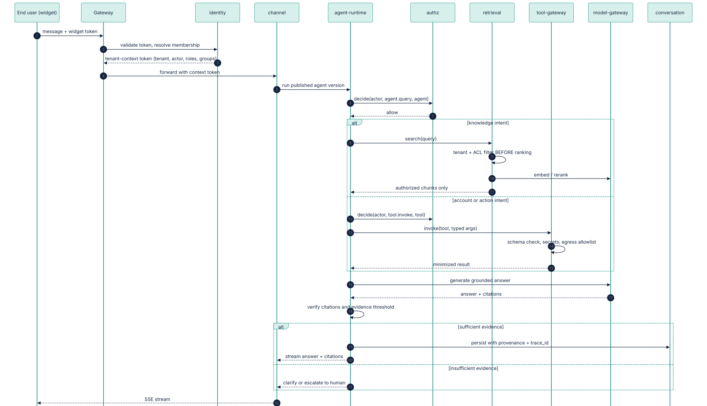
Figure: Request flow: tenant context, authorization, retrieval or tool call, grounded answer · source [request-sequence.mmd](../diagrams/src/request-sequence.mmd)

## 2. Communication

| Concern | Choice | Why |
|---|---|---|
| External API | REST + OpenAPI 3.1 (`/v1`), SSE for streaming | Universal; easy SDKs |
| Service-to-service sync | REST/JSON with **generated typed clients** from OpenAPI; gRPC allowed later for hot paths | Simple for a Python team; contracts stay explicit |
| Events | **NATS JetStream**, CloudEvents envelope, AsyncAPI-documented; **transactional outbox** in every service | Lightweight, cloud-agnostic, easy on-prem; Kafka adapter possible later |
| Long-running workflows | **Temporal** (ingestion, reindex, tenant deletion/export, eval runs) | Durable sagas across services; self-hostable |
| Agent state | LangGraph checkpointer in agent-runtime's own DB | Human-approval interrupts |
| Service identity | mTLS (Linkerd in K8s, optional on single node) + audience-scoped internal JWTs | Zero-trust between services |
| Tenant context | Gateway validates the user token; identity mints a short-lived **tenant-context token** (tenant, actor, roles, groups); every service verifies it and sets RLS from it | Tenant identity never comes from request bodies |

Figure: Reliable events: transactional outbox to NATS JetStream with idempotent consumers · source [events-outbox.mmd](../diagrams/src/events-outbox.mmd)

## 3. Data ownership

* **Database per service** (logically): separate schema + role per service in a shared Postgres cluster at
  MVP, so any service can move to its own cluster later. No cross-service SQL joins.
* **RLS in every tenant-scoped service DB**, `FORCE` enabled, non-owner roles, context from the tenant-context token.
* Read models built from events where a service needs another's data (e.g. metering).
* Object storage: per-tenant prefixes (shared tier) or per-tenant buckets (dedicated tier), chosen by config.
* Cross-service deletion and export run as Temporal sagas; every service implements `tenant.delete` / `tenant.export`.

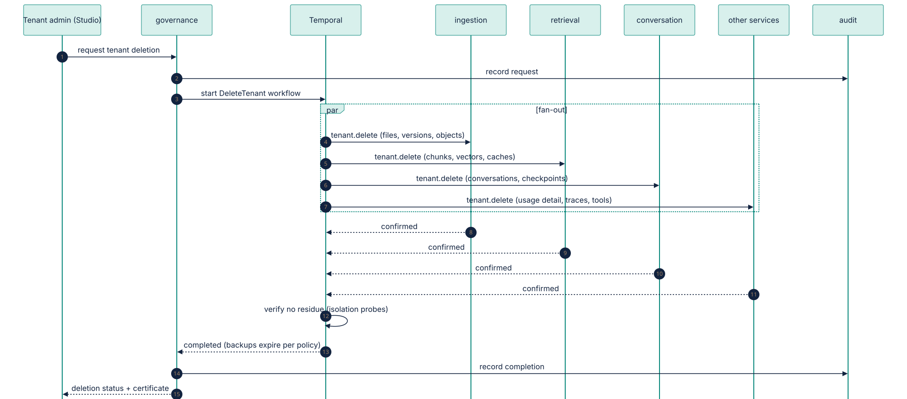
Figure: Tenant deletion saga across services · source [deletion-saga.mmd](../diagrams/src/deletion-saga.mmd)

## 4. Ports and adapters (generalization map)

| Port | Default adapter | Other adapters (planned) |
|---|---|---|
| Relational DB | PostgreSQL 16 | Any managed Postgres (RDS, Cloud SQL, Azure PG, Crunchy) |
| Vector store | pgvector | Qdrant, OpenSearch, Milvus (P2). Adapter must declare support for filter-before-rank |
| Keyword search | Postgres FTS | OpenSearch (P2) |
| Knowledge graph (P2) | Postgres tables + recursive CTEs | Dedicated graph DB (Neo4j / Memgraph) **only if evals prove the need** |
| Object storage | S3 API (DO Spaces, S3, GCS interop; SeaweedFS on-prem/dev) | Azure Blob native (P2) |
| Cache | Valkey / Redis | Managed Redis |
| Event bus | NATS JetStream | Kafka / Redpanda (P2) |
| Workflow engine | Temporal (self-hosted) | Temporal Cloud |
| Secrets | OpenBao / Vault | AWS/GCP/Azure secret managers (via External Secrets Operator) |
| KMS / encryption | OpenBao transit | Cloud KMS |
| Identity provider | Clerk, Keycloak, Auth0 | Any OIDC; SAML via Keycloak brokering |
| Authorization | OPA | Cedar (evaluated, not planned) |
| LLM / embeddings / rerank | OpenAI-compatible (OpenAI, vLLM, Ollama), Anthropic, Gemini | Azure OpenAI, Bedrock, Vertex |
| Malware scan | ClamAV | Cloud AV |
| Email | SMTP | SES, SendGrid, etc. |
| Observability | OpenTelemetry → collector → Grafana LGTM (Loki, Tempo, Mimir) + Langfuse | Any OTLP backend (Datadog, Cloud-native) |
| Feature flags | OpenFeature + flagd | Any OpenFeature provider |

Rule: **no vendor SDK is imported outside its adapter package.** A lint check enforces it.

Figure: Ports and adapters (dashed = planned after the pilot) · source [ports-adapters.mmd](../diagrams/src/ports-adapters.mmd)

## 5. Plugin model (extensibility without forking)

Plugin types share one SDK (`nexiqon-sdk`): manifest (id, version, config JSON Schema, capabilities, required
permissions), lifecycle hooks, a test kit, and registration with the config service.

| Plugin type | Examples | Runs in |
|---|---|---|
| Source connector | Web/sitemap crawler, file upload, S3 bucket, Git repo; later Confluence, SharePoint, Notion, Zendesk | ingestion |
| Parser / chunker | PDF, DOCX, HTML, MD, CSV/JSON; heading-aware or semantic chunking | ingestion |
| Tool adapter | Declarative REST, OpenAPI import, SDK connector, human-approval tool | tool-gateway |
| Graph node | retrieve, classify, call_tool, ask_clarification, validate_evidence, approve, escalate, respond, route | agent-runtime |
| Model provider | as port table | model-gateway |
| Channel | web widget, API; later Slack, Teams, email, WhatsApp | channel |
| Guardrail | PII detector, topic restriction, output checker | model-gateway / agent-runtime |
| Evaluator | Recall@k, citation support, LLM-judge, custom rules | evaluation |

First-party plugins only for the MVP. A third-party plugin sandbox is P2.

### 5.1 Ingestion pipeline (connector, parser and chunker plugins)

Figure: Secure ingestion workflow · source [ingestion-workflow.mmd](../diagrams/src/ingestion-workflow.mmd)

### 5.2 Agent graph (graph-node plugins)

Figure: Default declarative agent graph built from the node library · source [agent-graph.mmd](../diagrams/src/agent-graph.mmd)

### 5.3 Knowledge model: hierarchical retrieval (no graph database)

Decision: **no graph database in the MVP.** pgvector's HNSW index is already a layered navigable graph, so
similarity search already uses fast greedy graph traversal. Retrieval takes milliseconds while generation takes
seconds, so a second store would add isolation, deletion and footprint cost without making answers faster.

Structure is used for **answer quality** instead, all inside Postgres with RLS:

| Technique | What it does | Priority |
|---|---|---|
| **Document tree** | document › section › subsection › chunk, stored as `parent_id` + `ltree` path per node | P0 |
| **Small-to-big retrieval** | Match precise chunks, then expand to the parent section for context; size limits from the retrieval profile | P0 |
| **Section-path citations** | Citations show `Billing › Refunds, p.4`, not just a file name | P0 |
| **Summary nodes** (RAPTOR-style) | Section and document summaries embedded alongside chunks, so broad questions match summaries | P1, kept only if evals improve |
| **Knowledge-graph port** | Entities and relations for multi-hop domains (e.g. part › assembly › fault code › procedure) | P2, Postgres adapter first |

Retrieval latency is a measured budget: **P95 < 100 ms** per query (excluding reranker), tracked by the eval harness.

Figure: Document tree with small-to-big retrieval and summary nodes · source [hierarchical-retrieval.mmd](../diagrams/src/hierarchical-retrieval.mmd)

## 6. Configuration model (domain-agnostic)

### 6.1 Resolution hierarchy
`platform defaults → deployment → region → tenant → domain pack → agent → channel → environment overrides`

The most specific layer wins, except for **security floors**. Settings marked as floors (e.g. "write tools
require approval", "allowed model providers", "PII redaction on") can be tightened by lower layers but never
loosened.

Figure: Layered configuration with security floors · source [config-hierarchy.mmd](../diagrams/src/config-hierarchy.mmd)

### 6.2 Domain Pack (the unit of domain flexibility)
A versioned bundle (YAML/JSON, JSON-Schema validated, import/export, Git-friendly):

| Section | Contents |
|---|---|
| `vocabulary` | Domain terms and UI labels (e.g. "ticket" vs "work order"), localized |
| `intents` | Intent taxonomy, examples, routing to graph branches |
| `graph` | Declarative agent workflow composed from the node library |
| `prompts` | Prompt templates per node, per language; variables only, no secrets |
| `sources` | Recommended source connectors and chunking/retrieval profiles |
| `tools` | Tool definitions (OpenAPI refs / declarative REST), risk levels, confirmation policy |
| `entities` | Domain entity schemas used for slot filling and tool arguments |
| `guardrails` | Allowed topics, refusal rules, evidence thresholds, escalation rules |
| `channels` | Widget copy, starter questions, theme defaults |
| `evals` | Default test sets and release thresholds |
| `analytics` | Domain KPIs (e.g. deflection, resolution) |

Figure: Contents of a Domain Pack · source [domain-pack.mmd](../diagrams/src/domain-pack.mmd)

The templates (SaaS KA, Customer Support, E-commerce, Industrial Service, Enterprise Knowledge) are **Domain
Packs, not code**. **Acceptance test:** a second domain pack runs end to end with **zero code changes**.

### 6.3 Config lifecycle
Draft → validate (schema + policy floors) → eval run → publish (immutable version) → promote across
environments (dev → staging → prod) → rollback. Every change is audited and diffable. Studio and GitOps
(import/export) edit the same objects.

Figure: Configuration lifecycle: draft to production with eval gate and rollback · source [config-lifecycle.mmd](../diagrams/src/config-lifecycle.mmd)

### 6.4 Config-driven UI
Studio renders settings forms from the same JSON Schemas (with UI hints), so new config fields and plugins
appear in the UI without frontend work. Bespoke UX is still built for the main journeys (see UX.md).

## 7. Deployment modes (cloud-agnostic, hybrid)

| Mode | Control plane | Data plane | Typical customer |
|---|---|---|---|
| **Shared SaaS** | ThinkHive cloud | ThinkHive cloud, pooled + RLS | SMEs |
| **Dedicated SaaS** | ThinkHive cloud | ThinkHive cloud, dedicated DB/storage/namespace | Mid-market |
| **Hybrid** | ThinkHive cloud | **Customer's cloud or data centre**; data never leaves; outbound-only connection to control plane for config, policy bundles, redacted telemetry, usage | Regulated, data-sensitive |
| **Private** | Customer-hosted | Customer-hosted (air-gapped capable) | Gov, defence, strict on-prem |

Figure: One codebase, four deployment modes · source [deployment-modes.mmd](../diagrams/src/deployment-modes.mmd)

Figure: Hybrid mode: customer data plane, outbound-only link, split-origin Studio · source [hybrid-mode.mmd](../diagrams/src/hybrid-mode.mmd)

Plus **hybrid model routing** inside any mode: model-gateway routes by data classification and policy
(e.g. confidential collections → on-prem vLLM; public docs → frontier cloud model).

Packaging: one **Helm umbrella chart** (a subchart per service, composed into **deployment groups** by values), OpenTofu reference modules with **DigitalOcean first**, then AWS, GCP and Azure,
Docker Compose for dev and single-node on-prem, offline bundle for air-gapped installs. GitOps via Argo CD (optional).

## 8. Cross-cutting chassis (shared libraries, not shared services)

`nexiqon-core` (Python) used by every service: settings loader (layered config), tenant-context verification and
RLS session, structured logging, OTel tracing/metrics, error envelope, outbox + event publisher/consumer,
idempotency keys, health/readiness, typed service clients, test fixtures (two-tenant). `@nexiqon/ui` and
`@nexiqon/client` for TypeScript. A **service template** (Copier) generates a new service with all of this wired in.

## 9. Security invariants (enforced across services)

Figure: Tenant isolation: verified context, central authz, RLS · source [tenant-isolation.mmd](../diagrams/src/tenant-isolation.mmd)

1. Tenant context comes only from verified tokens and is re-verified by every service.
2. Authorization is decided by **authz**, not by agent-runtime, configuration or the LLM.
3. Retrieval filters by tenant and ACL **before** ranking, in every vector store adapter.
4. Secrets are resolved only inside tool-gateway / model-gateway adapters, never put in config, events, logs or prompts.
5. Configuration cannot loosen security floors.
6. In hybrid mode only redacted telemetry and usage leave the data plane. This is tested.
7. The cross-tenant isolation suite runs **across services**: API, events, workflows, caches, retrieval, tools.
