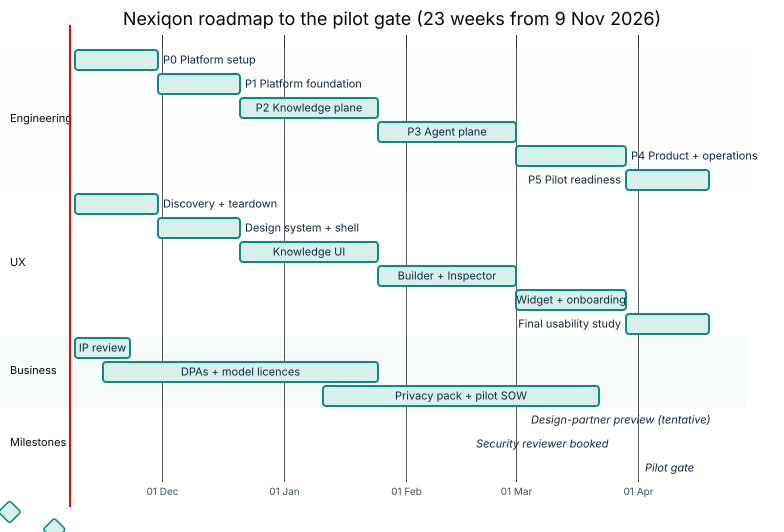

# Nexiqon — Implementation Plan (v3)

Source: *Nexiqon by ThinkHiveLabs — Technical Architecture & Product Strategy v1.1* (07 Nov 2026).
Related: [ARCHITECTURE.md](ARCHITECTURE.md) · [BACKLOG.md](BACKLOG.md) · [UX.md](UX.md) · [REVIEW.md](REVIEW.md)

**MVP target:** pass the design §15 pilot release gate with:
- the **SaaS Knowledge Assistant** domain pack, plus a **second domain pack with zero code changes**;
- **cloud** (frontier models) and **hybrid/on-prem** (open models) deployments from the same codebase;
- UX that meets the targets in UX.md §6.

---

## Progress

| Slice | Branch | Delivered |
|---|---|---|
| Phase 0 | `main` | Monorepo, chassis, 15 services from template, contracts, CI, dev stack, ADRs |
| P1 · slice 1 | `phase-1/identity-authz` | ID-01..04, AZ-01..02, PL-01, PL-03 |
| P1 · slice 2 | `phase-1/config` | CF-01..05, SaaS Knowledge Assistant pack v1 |
| P1 · slice 3 | `phase-1/events-audit` | EV-01, EV-02, AU-01, OB-01, CF-06 |
| P1 · slice 4 | `phase-1/studio-shell` | UX-04..06, ST-01..03; UX-07 script ready (sessions to run) |
| P2 · slice 1 | `phase-2/model-gateway` | M-01, M-03, M-04, M-05; M-02 without streaming (adapters tested against recorded wire shapes, not yet live); M-06, M-07 open |
| P2 · slice 2 | `phase-2/ingestion` | IN-01..08 and IN-07 (IN-09 summary nodes deferred: P1, gated on RT-05); retrieval index write side (part of RT-01); ADR 0017 |

## 1. Decisions

| # | Topic | Decision |
|---|---|---|
| D1 | Architecture | **Microservices** along bounded contexts, with a **control plane / data plane** split (ARCHITECTURE §1). Shared chassis library, contract-first APIs, events via outbox. **MVP packaging: 17 logical services run as 7 deployable groups** (REVIEW F1); any group splits later by config. |
| D2 | Generalization | Hexagonal **ports and adapters** for every external dependency; **plugin SDK** for connectors, parsers, tools, graph nodes, models, channels, guardrails, evaluators. |
| D3 | Configurability | **Domain Packs** + layered config hierarchy with security floors; declarative agent graphs; config-driven UI forms; GitOps import/export. |
| D4 | Domain | **Domain-agnostic** core; templates are Domain Packs. First pack: **SaaS Knowledge Assistant**; second pack (zero-code proof): **Customer Support**. |
| D5 | Cloud | **Cloud-agnostic**: Kubernetes + Helm; Compose for single-node; air-gapped bundle. **DigitalOcean is the first reference cloud** (§2.1); OpenTofu modules for AWS/GCP/Azure follow the same ports. |
| D6 | Hybrid | Four modes: Shared SaaS, Dedicated SaaS, **Hybrid** (our control plane, customer data plane), Private. Plus hybrid model routing by data classification. |
| D7 | Models | Provider-agnostic **model-gateway** with model profiles (cloud frontier / on-prem vLLM). Section 3. |
| D8 | Identity | Clerk (SaaS) · Keycloak (on-prem, bundled) · Auth0 (enterprise), behind one identity port. |
| D9 | Market | Global: i18n + RTL, multilingual retrieval, region-pinned data, GDPR / UK / CCPA / DPDP. |
| D10 | Team | We build everything in-house. Exception: an **independent** security review for the §15 gate. |
| D11 | UX | Primary differentiator; own track from week 0 (UX.md). |
| D12 | Go-to-market | **Design-partner preview** (tentative) at about week 16: one customer, dedicated single-tenant deployment on DigitalOcean, cloud model profile, SaaS KA pack, limited SOW. |
| D13 | Region | Chosen at deployment time per pilot customer (DigitalOcean regions cover US, EU, UK, India, Singapore, Australia). |
| D14 | Retrieval structure | **No graph DB.** Hierarchical document tree in Postgres (`ltree`), small-to-big retrieval, section-path citations; summary nodes P1 (eval-gated); knowledge-graph port P2 with a Postgres adapter first (ARCHITECTURE §5.3). |

> D1 deviates from design v1.1, which recommends a *modular monolith* to limit operational load (§15).
> Work item **S0-06** updates the design doc to v1.2. Mitigations are in REVIEW.md.

## 2. Technical stack

| Area | Choice |
|---|---|
| Backend services | Python 3.12, FastAPI, Pydantic v2, SQLAlchemy 2 (async), Alembic; one repo, one package per service |
| Shared chassis | `nexiqon-core` (Python), `nexiqon-sdk` (plugins), `@nexiqon/ui`, `@nexiqon/client` (TS); Copier service template |
| Contracts | OpenAPI 3.1 (sync), AsyncAPI + CloudEvents (events), JSON Schema (config); generated Python/TS clients; contract tests (Schemathesis) |
| Edge | Envoy Gateway (Kubernetes Gateway API) |
| Events | NATS JetStream + transactional outbox |
| Workflows | Temporal (self-hosted) |
| Agent engine | LangGraph, declarative graphs from config |
| Authorization | OPA (Rego) with policy bundles from config |
| Data | PostgreSQL 16 + pgvector + FTS (schema and role per service, RLS); Valkey; S3-compatible storage |
| Secrets / KMS | OpenBao (Vault-compatible); External Secrets Operator for cloud managers |
| Service mesh | Linkerd (mTLS), optional on single-node |
| Model serving | vLLM (on-prem), Ollama (dev); OpenAI, Anthropic, Gemini adapters |
| Observability | OpenTelemetry → collector → Grafana LGTM; Langfuse for LLM traces |
| Feature flags | OpenFeature + flagd |
| Frontend | Next.js (App Router) + TS, Tailwind, shadcn/ui + Radix, TanStack Query, react-hook-form + zod, next-intl, JSON-Schema forms (RJSF or similar, with our components) |
| Widget | Web Component (Lit), Shadow DOM, < 60 KB gzipped |
| Local dev | Tilt + kind (full stack) or Compose profiles (subset) |
| Testing | pytest, testcontainers, Hypothesis, Schemathesis, Vitest, Playwright, axe-core, Storybook, k6 |
| CI/CD | GitHub Actions (path-filtered per service), pip-audit, npm audit, gitleaks, trivy, SBOM, image signing (cosign) |
| IaC / GitOps | OpenTofu, Helm umbrella chart, Argo CD (optional) |

### 2.1 DigitalOcean reference deployment

| Need | DigitalOcean service | Notes |
|---|---|---|
| Kubernetes | **DOKS** | Hosts all 7 deployment groups, NATS, Temporal, OPA, OpenBao, Keycloak (if used) |
| PostgreSQL + pgvector | **Managed PostgreSQL** (pgvector supported, PG 13+) | From 30 Nov 2026, Standard Edition plans are limited to ≤ 4 GiB RAM and have **no standby nodes**: production/HA needs the higher edition. Verify pricing at DV-03 |
| Cache | **Managed Valkey** | Via the cache port |
| Object storage | **Spaces** (S3-compatible) | Via the storage port; per-tenant prefixes |
| Images | DigitalOcean Container Registry | Signed images (cosign) |
| Secrets | *No managed secret manager* → **OpenBao on DOKS** | Already the default adapter |
| On-prem model testing | **GPU Droplets** | Rent for M-06/M-07 and hybrid staging; verify available GPU types and pricing |
| Ingress | DO Load Balancer → Envoy Gateway | TLS via cert-manager |
| Observability | Self-hosted LGTM + Langfuse on DOKS | OTLP, so it can move to any backend |

Nothing DigitalOcean-specific is used outside OpenTofu modules and Helm values, so the same chart runs on AWS, GCP, Azure or on-prem.

## 3. Model strategy

All model use goes through **model-gateway** using a named *model profile*:
`{chat, embedding, reranker, capability flags, budgets, data_policy, routing_rules}`.

| Profile | Chat LLM | Embeddings (1024-d) | Reranker | Hardware |
|---|---|---|---|---|
| Cloud – frontier | OpenAI, Anthropic, Gemini adapters (+ Azure OpenAI / Bedrock / Vertex). Default chosen by bake-off (M-07) | OpenAI `text-embedding-3-small`, `dimensions=1024` | Optional | — |
| **On-prem – standard** | Qwen3.6-35B-A3B-class MoE (*verify at M-07*) | Qwen3-Embedding-0.6B | Qwen3-Reranker-0.6B | 1× 24–48 GB GPU |
| On-prem – small | Qwen3-8B (FP8) | Qwen3-Embedding-0.6B | Qwen3-Reranker-0.6B | 1× 24 GB GPU |
| On-prem – large | gpt-oss-120b or larger Qwen MoE | Qwen3-Embedding-4B @1024 | Qwen3-Reranker-4B | 80 GB / multi-GPU |
| Dev | Small Qwen via Ollama | Qwen3-Embedding-0.6B | off | laptop |

**Hybrid routing:** rules like "collections tagged `confidential` → on-prem profile; else → cloud". A tenant
data policy can forbid cloud providers entirely (a security floor). Embedding models are never mixed in one
index; the model is recorded per chunk and switching triggers a reindex workflow.

Figure: Hybrid model routing in model-gateway · source [model-routing.mmd](../diagrams/src/model-routing.mmd)

## 4. Phases and milestones

| Phase | Weeks | Exit criteria |
|---|---|---|
| **0. Platform setup + UX discovery** | 0–2 | Monorepo, CI, contracts pipeline, chassis v0, service template, Tilt/kind dev env, ADRs, design doc v1.2; competitor teardown, personas, journeys |
| **1. Platform foundation** | 3–5 | Gateway, identity (Clerk + Keycloak), authz (OPA), config service (domain packs, layering, versions), audit, events + outbox, Temporal, distributed tracing, **cross-service isolation harness**; design system; Studio shell |
| **2. Knowledge plane** | 6–10 | model-gateway (cloud + vLLM), ingestion (connector/parser plugins, workflows), retrieval (hybrid, ACL, citations), vector-store port; Knowledge UI; Recall@5 measured |
| **3. Agent plane** | 11–15 | agent-runtime with declarative graphs + node library, tool-gateway, conversation + handoff, channel service; Builder, Playground + Answer Inspector, Actions UI; basic widget cut. **→ Design-partner preview (week 16, tentative)** |
| **4. Product + operations** | 16–19 | Widget, onboarding, evaluation + release gate, metering/insights, governance sagas, notification; i18n, a11y; Helm/OpenTofu; **hybrid data-plane mode** |
| **5. Pilot readiness** | 20–22 | §13 demo e2e on SaaS **and** hybrid; **Customer Support** pack with zero code change; load baselines; independent security review; usability study meets targets |

Figure: Roadmap: engineering, UX and business tracks · source [roadmap-gantt.mmd](../diagrams/src/roadmap-gantt.mmd)

About **23 weeks** to the pilot gate (≈ 19 Apr 2027 if work starts 9 Nov 2026). Packaging services as 7 deployable
groups saves about 3 weeks against the 17-deployable plan. The design-partner preview at week 16 brings the first
customer about 7 weeks before the gate.

## 5. Critical path

Figure: Critical path with the parallel UX track · source [critical-path.mmd](../diagrams/src/critical-path.mmd)

## 6. Engineering rules (all phases)

1. **Contract first.** OpenAPI/AsyncAPI/JSON Schema change is reviewed before implementation; breaking changes need a new version.
2. **Every service from the template.** Chassis, health, tracing, RLS, outbox, isolation fixtures included by default.
3. **No vendor SDK outside its adapter.** Lint-enforced.
4. **No domain words in core services.** Lint (word list) + review; domain lives in packs.
5. **Policy before model.** Authz decides; configuration and LLMs cannot grant access.
6. **Isolation suite grows with every endpoint, event consumer and workflow.**
7. **No feature without UX.** Done = UI with designed states, i18n strings, a11y clean.
8. **Both model profiles in CI** (cloud mocked/recorded; small on-prem model in nightly).
9. **Every service is independently deployable and observable** (traces, metrics, logs, SLO dashboards).

## 7. Business / legal track

IP review, provider DPAs (OpenAI, Anthropic, Google, Clerk, Auth0, cloud), open-model licences, global privacy
pack, pilot SOW, cost model, pilot pipeline (incl. ≥1 hybrid candidate), security reviewer booking. See backlog **B**.

## 8. Open items

1. Budget/vendor for the independent security review (book by week 14).
2. Confirm the design-partner preview and identify the candidate customer (B-07).
3. Region and DigitalOcean database edition, decided at deployment time.
4. GPU Droplet type for on-prem model testing (decide at M-06).
