# Nexiqon — Plan Review (v3)

Scope: PLAN.md, ARCHITECTURE.md, BACKLOG.md, UX.md, checked against design v1.1 and the decisions taken.

## 1. Coverage against the design document

| Design requirement | Covered by | Status |
|---|---|---|
| FR-01 Agent config, versions, publish/rollback | CF-01, CF-03, ST-06, QA-02 | ✅ |
| FR-02 Document ingestion + lifecycle | IN-01…IN-07, ST-04 | ✅ |
| FR-03 Grounded Q&A with citations | RT-02, RT-03, AG-01 | ✅ |
| FR-04 Tenant-bound business tools | T-01…T-05, ST-09 | ✅ |
| FR-05 Conversation + escalation | CV-01, CV-02, W-03 | ✅ |
| FR-06 Observability + evaluation | OB-01, QA-01, MT-01, ST-07 | ✅ |
| FR-07 Deployment portability | S0-07, DV-01…DV-09 | ✅ (extended to hybrid) |
| §6 Security controls + acceptance tests | ID-03, AZ-*, PL-03, AG-03, T-05, S-*, R-06 | ✅ |
| §7 Privacy, retention, deletion | G-01, G-02, M-04, B-04 | ✅ |
| §9 REST endpoints | Exposed through gateway, owned by services | ✅ |
| §11 Quality targets | RT-05, QA-01, M-07, R-04 | ✅ |
| §13 Demo scenario | R-01, R-02 | ✅ |
| §15 Pilot release gate | R-08 (+ R-06 external review) | ✅ |
| §15 "Modular monolith" mitigation | **Deviated** (microservices); S0-06 updates design to v1.2 | ⚠ see F1 |

All functional requirements are covered. Every deviation is deliberate and recorded.

## 2. Strengths

- **Domain-agnostic for real:** Domain Packs, declarative graphs, vocabulary injection, plus a release check (R-02) that a second domain needs **zero code**. This is enforceable, not just a slogan.
- **Hybrid built in from the start:** the control/data plane split, config snapshots and the split-origin Studio are designed in Phase 1, not bolted on.
- **Generalization is enforced:** a port for every dependency, a lint rule against vendor SDKs, a plugin SDK, schema-driven UI.
- **Security survives the split into services:** tenant-context tokens, central authz, cross-service isolation harness, security floors in config.
- **UX is wired into delivery:** every phase ends with a usability test, and the definition of done includes UI states, i18n and a11y.

## 3. Findings

| # | Severity | Finding | Recommendation |
|---|---|---|---|
| F1 | **High** | **Microservices vs team capacity.** 17 deployables and about 150 work items, built entirely in-house. The risk is that platform work crowds out UX, which is the stated priority. The design doc chose a modular monolith for exactly this reason. | Keep **17 logical services** (separate packages, contracts, DB schemas, events) but run them as **~7 deployable groups** for the MVP: `edge`, `control-core` (identity+authz+config+audit), `control-ops` (evaluation+metering+governance+notification), `knowledge` (ingestion+retrieval), `agent` (agent-runtime+conversation+channel), `tool-gateway`, `model-gateway`. Split any group into separate pods later with config only. Saves about 3–4 weeks of ops work without losing any boundaries. |
| F2 | **High** | **25 weeks to the first pilot conflicts with "implementation-first" cash flow** (design §1, §14). | Offer a **design-partner preview at about week 14–16**: one customer, **dedicated single-tenant** deployment (no pooled multi-tenant risk), cloud profile, SaaS KA pack, under a limited SOW. It funds the work and validates UX early. The full §15 gate still applies to the multi-tenant pilot. |
| F3 | Medium | **Configurability vs simplicity.** Everything configurable can easily become a cluttered UI. | Domain Packs supply defaults; progressive disclosure; usability test acceptance: "onboarding completed without opening Advanced". Track how often config fields are actually used. |
| F4 | Medium | **Hybrid content flow.** In hybrid mode, the Inspector, Playground and document previews would route customer content through our control plane. | Added **DV-08** (split-origin Studio). This must be designed in Phase 1 (ID-03, CF-05), even though it ships in Phase 4. |
| F5 | Medium | **Heavy on-prem footprint** (NATS, Temporal, OPA, OpenBao, Linkerd, LGTM, Langfuse, vLLM). Too much for smaller on-prem customers. | Added **DV-09** (minimum footprint profile). Make mesh and observability stacks optional. Later, consider an all-in-one mode (P2). |
| F6 | Medium | **Distributed deletion and isolation are the hardest correctness problems** and may be undersized (G-02, PL-03). | Treat both as L+ and start PL-03 in Phase 1 (done). G-02 needs every service to implement a `tenant.delete` handler from the template, so add it to S0-05. |
| F7 | Medium | **Model choices not yet verified.** The Qwen3.6-35B-A3B-class recommendation is based on uneven public sources. | M-07 bake-off decides, with a licence check (B-03). Qwen3-8B remains the guaranteed fallback. |
| F8 | Low | **Event and workflow ordering bugs** are hard to test across services. | Outbox + idempotent consumers in the chassis; contract tests for events (AsyncAPI); chaos tests (R-05). |
| F9 | Low | **Infra version drift** across 17 services. | Shared chassis versions pinned via the uv workspace; Renovate for dependency updates; one Helm umbrella version per release. |
| F10 | Low | **Multilingual quality unmeasured** for non-English pilot users. | RT-05 includes a multilingual gold subset; add language as a scorecard dimension in QA-01. |

### Proposed MVP deployment groups (F1)

Figure: 17 logical services packaged as 7 deployable groups · source [deployment-groups.mmd](../diagrams/src/deployment-groups.mmd)

## 4. Decisions (updated)

| # | Decision | Recommendation |
|---|---|---|
| 1 | MVP deployment granularity (F1): 17 separate deployables vs ~7 groups ✅ **Accepted**: 7 groups, logical microservices preserved |
| 2 | Design-partner preview at week 14–16 (F2) ✅ **Accepted (tentative)**: week 16, dedicated single-tenant on DigitalOcean |
| 3 | Second domain pack for the zero-code demo ✅ **Accepted**: Customer Support |
| 4 | First SaaS region ⏳ Deferred to deployment time; **DigitalOcean** is the first reference cloud |
| 5 | Security reviewer budget/vendor ⏳ Open: book by week 14 |
| 6 | GPU for on-prem testing ⏳ Open: rent DigitalOcean GPU Droplets; type chosen at M-06 |

## 5. Verdict

The plan is complete against the design and matches the stated goals: microservices, generalization,
configurability, domain-agnostic, cloud-agnostic, hybrid and UX-first. The main risk is **capacity, not
architecture**. Taking recommendations 1 and 2 keeps the architecture intact while cutting about 3–4 weeks and
bringing the first paying user forward by about 10 weeks.
