# Nexiqon — UX Strategy, Competitor Comparison & Gap Plan

UX is Nexiqon's primary differentiator. This document sets out who we design for, what competitors do
well and badly, the gaps we will cover, and measurable UX targets. Work items are in
[BACKLOG.md](BACKLOG.md) (prefix `UX-`, `ST-`, `W-`). Architecture: [ARCHITECTURE.md](ARCHITECTURE.md).

> **Evidence note:** the competitor observations below come from public product material and general
> market knowledge up to mid-2026. Products change fast. Item **UX-01** verifies each one with a hands-on
> trial before we treat it as fact.

---

## 1. Who we design for

| Persona | Goal | What "user-friendly" means to them |
|---|---|---|
| **Knowledge Manager / Support Lead** (primary) | Get an accurate assistant live on their docs and keep it accurate | No code; sees *why* an answer happened; fixes bad answers in one click |
| **Tenant Admin / IT** | Control access, identity, data, cost | Clear permissions, audit, retention, model/provider policy in plain language |
| **Developer / Integrator** | Connect account APIs, embed the widget | Copy-paste embed; test a tool call without guesswork; good errors |
| **End user** (the customer's customer) | Get the answer fast, or reach a human | Fast, cited, honest when unsure, easy handoff, own language, accessible |
| **ThinkHive operator** | Run many tenants and deployments | Tenant health, usage, incidents at a glance |

## 2. Competitor landscape (to verify in UX-01)

Groups compared: **support-AI suites**, **docs/KA assistants**, **no-code builders**, **open-source / self-host platforms**, **enterprise agent platforms**.

| Product | Category | UX strengths to learn from | UX weaknesses / gaps we can exploit |
|---|---|---|---|
| Intercom Fin | Support suite | Very polished; guided setup; test answers before going live; content-based "train" model | Tied to Intercom helpdesk; SaaS only; limited view of retrieval/model internals; no on-prem |
| Zendesk AI agents | Support suite | Deep ticketing integration; familiar to support teams | Complex admin spread over many screens; weak transparency into why an answer was given |
| kapa.ai | Docs/KA assistant | Fast setup on developer docs; good source citations; analytics of unanswered questions | Narrow (docs Q&A); limited actions/tools; SaaS only |
| Inkeep | Docs/KA assistant | Strong docs-site integration, search plus chat, content-gap reporting | Docs-centric; less control over tools, permissions and deployment |
| Chatbase / CustomGPT.ai | No-code chatbot | Minutes to first bot; simple upload; easy widget styling | Shallow governance (ACL, audit, versioning); limited evaluation; not enterprise-grade isolation |
| Botpress / Voiceflow | Builder | Visual flow design, collaboration, a good test emulator | Flow-builder learning curve; RAG transparency is limited; self-host options limited or partial |
| Dify / Flowise / Langflow | Open-source LLM app builders | Self-hostable; model-agnostic; quick prototyping | Developer-oriented UI; weak multi-tenancy, ACL and enterprise governance; polish varies |
| Microsoft Copilot Studio | Enterprise builder | Microsoft 365 integration, enterprise identity | Heavy, Microsoft-centric; complex licensing; steep learning curve |
| Glean | Enterprise search/assistant | Permission-aware enterprise search; great search UX | Internal-knowledge focus, not customer-facing; premium, sales-led |
| Sierra / Decagon / Ada | Enterprise customer-agent platforms | Strong outcome focus; conversation review tooling | Sales-led, service-heavy onboarding; little self-serve; no self-host |

## 3. Gaps Nexiqon will cover (our UX differentiators)

| # | Gap in market | Nexiqon answer | Backlog |
|---|---|---|---|
| G1 | Admins can't see **why** an answer happened | **Answer Inspector**: for any message, show retrieved sources with scores, what was filtered by ACL (count only, no content), tool calls, model, cost, latency, and a plain-language "why" | ST-07 |
| G2 | Fixing a bad answer is slow | **One-click fix loop**: from a bad answer → edit source / add Q&A snippet / mark source outdated → re-test instantly → becomes an eval case | ST-14, RT-04 |
| G3 | Unknown **content gaps** | **Gap report**: clusters of unanswered/escalated/low-confidence questions with suggested doc topics | MT-02, ST-18 |
| G4 | Publishing is risky | **Safe publish**: draft → automatic eval run → diff of config and score changes vs live → publish → one-click rollback | ST-06, QA-02 |
| G5 | Permissions are invisible | **"View as" preview**: test the agent as a given user/group and see exactly what they can retrieve | ST-08 |
| G6 | Tools/actions are scary | **Action cards**: every write action shows a clear human confirmation; admins see a risk badge, an allowlist, and a dry-run test console | ST-09, W-03 |
| G7 | Cloud vs on-prem means different products | **Same UI everywhere**; model profile chosen from a picker with plain-language trade-offs (quality / cost / data location); hybrid routing rules shown as a simple data-flow view | ST-12 |
| G8 | Cost surprises | **Cost meter** per agent, conversation and tenant, with budgets and alerts | MT-01, ST-18 |
| G9 | Setup takes days | **Under-10-minute onboarding**: paste docs URL → crawl → auto-suggested starter questions → test → embed snippet | ST-13 |
| G10 | Global users poorly served | i18n UI, RTL, answers in the user's language, WCAG 2.2 AA | UX-06, UX-10, W-02 |
| G11 | End users dead-end | Widget: honest "I'm not sure", visible sources, one-tap human handoff with context carried over, conversation transcript email | W-03 |
| G12 | Each domain needs a different product or custom build | **Domain Packs**: pick a pack in onboarding; vocabulary, intents, prompts, guardrails, starter questions and widget copy all adapt; editable in a **Domain Pack editor** with no code | ST-10, UX-06, CF-04 |
| G13 | New settings/plugins need UI work | **Schema-driven forms**: every config type and plugin renders its settings automatically and consistently | ST-02 |

### Key journeys

Figure: Onboarding: sign-up to live in under 10 minutes (G9) · source [onboarding-journey.mmd](../diagrams/src/onboarding-journey.mmd)

Figure: One-click fix loop (G1 + G2) · source [fix-loop.mmd](../diagrams/src/fix-loop.mmd)

## 4. UX principles

1. **Time to value first.** A new tenant sees a correct, cited answer to their own docs within 10 minutes.
2. **Show your work.** Every AI output links to its evidence; uncertainty is shown, not hidden.
3. **Safe by default, powerful on demand.** Sensible defaults; advanced settings go behind progressive disclosure.
4. **Every state is designed.** Empty, loading, partial, error, permission-denied, and long-running job states.
5. **Plain language.** No "chunking profile" on the main path; the "Advanced" panels use technical terms.
6. **Keyboard-first, accessible.** Command palette (⌘K), full keyboard navigation, WCAG 2.2 AA.
7. **Consistency.** One design system; one way to do lists, filters, forms, confirmations, toasts.

## 5. Studio information architecture

Figure: Studio information architecture · source [studio-ia.mmd](../diagrams/src/studio-ia.mmd)

## 6. UX targets (measured in usability tests and in product)

| Metric | Target for the pilot |
|---|---|
| Sign-up → first cited answer on own docs | ≤ 10 min, unassisted, for 4 of 5 test users |
| Embed widget on a site | ≤ 5 min |
| Find why an answer was wrong and fix it | ≤ 3 min |
| System Usability Scale (SUS) | ≥ 80 |
| Accessibility | WCAG 2.2 AA, zero critical axe violations |
| Widget performance | < 60 KB gzipped, first token shown < 2 s on cloud profile (measured, P50) |
| Studio performance | LCP < 2.5 s, INP < 200 ms on key pages |

## 7. UX process

Discovery (UX-01..03) → design system (UX-04..06) → low-fidelity flows for each epic before backend
starts → built directly as coded prototypes in Studio → usability test at the end of each phase
(5 users) → fixes go into the next phase's first week.
